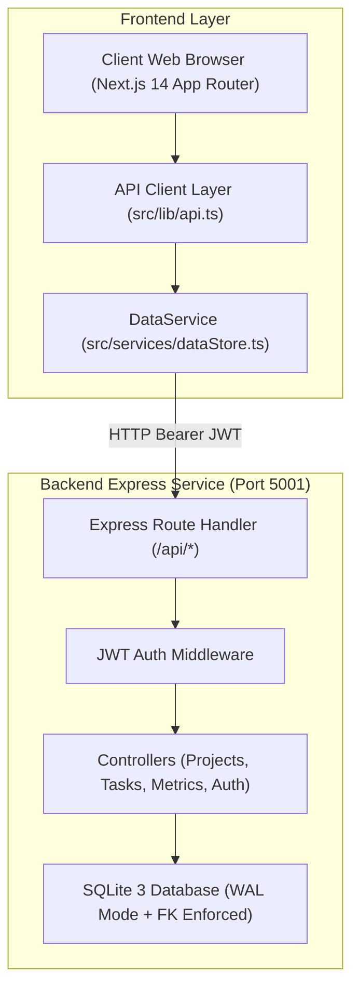

# TaskFlow — Master Architecture, API & Implementation Specification
> **Comprehensive System Blueprint for Autonomous Re-Implementation**  
> *Target Audience:* Autonomous AI Coding Agents, Full-Stack Engineers, Software Architects.  
> *Version:* 3.0.0 (Pure SQL Edition)  
> *Document Purpose:* Complete, end-to-end specifications enabling an AI model or developer to reconstruct the entire TaskFlow application (frontend, backend, database, APIs, design system, and business logic) from scratch without ambiguity.

---

## Table of Contents
1. [Executive System Overview](#1-executive-system-overview)
2. [Technology Stack & Core Dependencies](#2-technology-stack--core-dependencies)
3. [Relational Database Schema & SQLite WAL Engine](#3-relational-database-schema--sqlite-wal-engine)
4. [Complete REST API Endpoints Specification](#4-complete-rest-api-endpoints-specification)
5. [Authentication, JWT & RBAC Governance Matrix](#5-authentication-jwt--rbac-governance-matrix)
6. [Frontend Architecture & Senior 6-Zone Clean Code Standard](#6-frontend-architecture--senior-6-zone-clean-code-standard)
7. [Comprehensive Page & Route Implementation Guide](#7-comprehensive-page--route-implementation-guide)
8. [Kanban Engine, Drag-and-Drop & Strict Business Rules](#8-kanban-engine-drag-and-drop--strict-business-rules)
9. [Tactile Design Tokens, Ant Design Theme & Zero-Emoji Policy](#9-tactile-design-tokens-ant-design-theme--zero-emoji-policy)
10. [Bilingual Parity: English (LTR) & Arabic (RTL) System](#10-bilingual-parity-english-ltr--arabic-rtl-system)
11. [Step-by-Step Reconstruction & Deployment Runbook](#11-step-by-step-reconstruction--deployment-runbook)

---

## 1. Executive System Overview

**TaskFlow** (Arabic: **تاسك_فلو**) is an enterprise-grade project and task orchestration system designed for high-velocity software engineering teams. It marries the deterministic speed and reliability of a pure relational SQLite WAL database with a tactile, high-contrast, bilingual Next.js web application.

### Key Capabilities:
- **Dual-Engine Architecture:** Express.js REST API with SQLite WAL persistence alongside an intelligent failover frontend client.
- **Relational Integrity:** Foreign key constraints with automatic cascade deletion for projects and tasks (`ON DELETE CASCADE`).
- **Tactile High-Contrast UI:** Built on Ant Design 5 and Tailwind CSS with Warm Charcoal / Pure Sand aesthetic, zero AI slop, and **strict zero-emoji policy** (vector SVGs and AntD icons only).
- **Kanban Board with Strict Business Rules:** Native HTML5 drag-and-drop with optimistic UI updates. The task creation button (`+`) is strictly isolated to the **`todo`** column header only.
- **Bilingual Parity:** Seamless instant switching between English (`en`, LTR, "TaskFlow") and Arabic (`ar`, RTL, "تاسك_فلو").
- **Slide-over Drawer & Command Palette:** Quick inspection drawer (`TaskDetailDrawer`), global keyboard palette (`Cmd+K` / `Ctrl+K`), and velocity progress tracking.



---

## 2. Technology Stack & Core Dependencies

### 2.1 Frontend Environment
- **Framework:** Next.js 16.4.2 (App Router, React 18 / 19, TypeScript 5)
- **Styling:** Tailwind CSS 3.4+, PostCSS, Autoprefixer
- **Component System:** Ant Design 5.24+ (`antd`), `@ant-design/icons`
- **Typography & Font Optimization:** Inter (Latin), IBM Plex Sans Arabic / Noto Sans Arabic, JetBrains Mono
- **HTTP / Fetching:** Native `fetch` with custom failover wrapper (`apiRequest`)
- **Validation:** Zod 3.23+

### 2.2 Backend Environment
- **Runtime:** Node.js 20+ LTS, Express.js 4.19+ (ESM modules)
- **Database Engine:** SQLite 3 (`sqlite3` driver) in Write-Ahead Logging (`WAL`) mode
- **Security & Headers:** `helmet` 7.1+, `cors` 2.8+, `bcryptjs` 2.4+ (12 salt rounds)
- **Tokens & Auth:** `jsonwebtoken` 9.0+ (HMAC SHA-256)
- **UUID Generation:** `uuid` v4
- **Logging & Monitoring:** `morgan` (combined access logs)

---

## 3. Relational Database Schema & SQLite WAL Engine

The database runs on SQLite 3 with strict relational settings enforced on connection bootstrap:
```sql
PRAGMA foreign_keys = ON;
PRAGMA journal_mode = WAL;
PRAGMA synchronous = NORMAL;
```

### 3.1 Data Definition Language (DDL)

```sql
-- 1. USERS TABLE
CREATE TABLE IF NOT EXISTS users (
  id TEXT PRIMARY KEY,
  email TEXT UNIQUE NOT NULL,
  password_hash TEXT NOT NULL,
  display_name TEXT NOT NULL,
  role TEXT NOT NULL DEFAULT 'member', -- 'owner' | 'member' | 'trainee'
  created_at TEXT NOT NULL,
  updated_at TEXT NOT NULL
);

-- 2. PROJECTS TABLE
CREATE TABLE IF NOT EXISTS projects (
  id TEXT PRIMARY KEY,
  name TEXT NOT NULL,               -- 3 to 80 characters
  description TEXT,                 -- max 1000 characters
  owner_id TEXT NOT NULL,
  created_at TEXT NOT NULL,
  updated_at TEXT NOT NULL,
  FOREIGN KEY (owner_id) REFERENCES users(id) ON DELETE CASCADE
);

-- 3. PROJECT MEMBERS TABLE (Many-to-Many RBAC)
CREATE TABLE IF NOT EXISTS project_members (
  project_id TEXT NOT NULL,
  user_id TEXT NOT NULL,
  role TEXT NOT NULL DEFAULT 'member', -- 'owner' | 'member' | 'trainee'
  joined_at TEXT NOT NULL,
  PRIMARY KEY (project_id, user_id),
  FOREIGN KEY (project_id) REFERENCES projects(id) ON DELETE CASCADE,
  FOREIGN KEY (user_id) REFERENCES users(id) ON DELETE CASCADE
);

-- 4. TASKS TABLE
CREATE TABLE IF NOT EXISTS tasks (
  id TEXT PRIMARY KEY,
  project_id TEXT NOT NULL,
  title TEXT NOT NULL,              -- 3 to 120 characters
  description TEXT,                 -- max 1000 characters
  status TEXT NOT NULL DEFAULT 'todo', -- 'todo' | 'in_progress' | 'done'
  priority TEXT NOT NULL DEFAULT 'medium', -- 'low' | 'medium' | 'high'
  assignee_id TEXT,
  created_by TEXT NOT NULL,
  due_date TEXT,                    -- YYYY-MM-DD
  created_at TEXT NOT NULL,
  updated_at TEXT NOT NULL,
  FOREIGN KEY (project_id) REFERENCES projects(id) ON DELETE CASCADE,
  FOREIGN KEY (assignee_id) REFERENCES users(id) ON DELETE SET NULL,
  FOREIGN KEY (created_by) REFERENCES users(id) ON DELETE CASCADE
);

-- Performance Relational Indexes
CREATE INDEX IF NOT EXISTS idx_users_email ON users(email);
CREATE INDEX IF NOT EXISTS idx_projects_owner ON projects(owner_id);
CREATE INDEX IF NOT EXISTS idx_project_members_user ON project_members(user_id);
CREATE INDEX IF NOT EXISTS idx_tasks_project ON tasks(project_id);
CREATE INDEX IF NOT EXISTS idx_tasks_assignee ON tasks(assignee_id);
CREATE INDEX IF NOT EXISTS idx_tasks_status ON tasks(status);
```

### 3.2 Default Seed Personas (Testing & Evaluation)
When `SEED_DEMO_DATA=true` or initialized, default passwords are `password123`:
1. **Admin / Owner:** `owner@taqat-gaza.com` (Role: `owner`, Display Name: "Enterprise Admin")
2. **Lead Engineer:** `member@taqat-gaza.com` (Role: `member`, Display Name: "Lead Engineer")
3. **Software Trainee:** `trainee@taqat-gaza.com` (Role: `trainee`, Display Name: "Software Trainee")

---

## 4. Complete REST API Endpoints Specification

All API routes are prefixed by `/api`. Every authenticated endpoint expects:
`Authorization: Bearer <JWT_TOKEN>`

### 4.1 System & Health

#### `GET /api/health`
- **Auth:** Public
- **Description:** Returns server engine health, SQLite tables count, security configurations, and process uptime.
- **Response `200 OK`:**
```json
{
  "status": "ok",
  "service": "TaskFlow Enterprise REST API",
  "version": "3.0.0",
  "engine": "TaskFlow Standalone SQL Service",
  "database": {
    "type": "SQLite Relational Engine",
    "status": "healthy",
    "tablesCount": 4
  },
  "port": 5001,
  "environment": "production",
  "security": {
    "helmet": true,
    "rateLimiter": "active",
    "hsts": "max-age=31536000",
    "frameGuard": "DENY",
    "authProtocols": ["Authorization: Bearer <jwt>"]
  },
  "uptimeSeconds": 8420,
  "timestamp": "2026-10-20T16:00:00.000Z"
}
```

---

### 4.2 Authentication Endpoints

#### `POST /api/auth/register`
- **Auth:** Public
- **Request Body:**
```json
{
  "email": "engineer@company.com",
  "password": "strongPassword123",
  "displayName": "Alex Morgan",
  "role": "owner" // "owner" | "member" | "trainee" (optional, default: "member")
}
```
- **Validation:**
  - `email`: valid email format, trimmed, lowercased.
  - `password`: minimum 8 characters.
  - `displayName`: 1-100 characters.
- **Response `201 Created`:**
```json
{
  "status": "success",
  "message": "Account registered successfully in SQL database.",
  "token": "eyJhbGciOiJIUzI1NiIsInR5cCI6IkpXVCJ9...",
  "user": {
    "id": "uuid-v4",
    "uid": "uuid-v4",
    "email": "engineer@company.com",
    "displayName": "Alex Morgan",
    "role": "owner",
    "createdAt": "2026-10-20T16:00:00.000Z"
  }
}
```
- **Error `409 Conflict`:** `{"error": "An account with this email address already exists.", "code": "USER_ALREADY_EXISTS"}`

#### `POST /api/auth/login`
- **Auth:** Public
- **Request Body:**
```json
{
  "email": "owner@taqat-gaza.com",
  "password": "password123"
}
```
- **Response `200 OK`:**
```json
{
  "status": "success",
  "token": "eyJhbGciOiJIUzI1NiIsInR5cCI6IkpXVCJ9...",
  "user": {
    "id": "user-uuid",
    "uid": "user-uuid",
    "email": "owner@taqat-gaza.com",
    "displayName": "Enterprise Admin",
    "role": "owner",
    "createdAt": "2026-10-18T10:00:00.000Z"
  }
}
```
- **Error `401 Unauthorized`:** `{"error": "Invalid email or password credentials.", "code": "INVALID_CREDENTIALS"}`

#### `GET /api/auth/me`
- **Auth:** Bearer Token
- **Response `200 OK`:** Returns authenticated user profile.

#### `GET /api/auth/users`
- **Auth:** Bearer Token
- **Description:** Returns list of all registered users (used for team member invitation autocomplete).
- **Response `200 OK`:**
```json
{
  "users": [
    {
      "id": "user-1",
      "uid": "user-1",
      "email": "member@taqat-gaza.com",
      "displayName": "Lead Engineer",
      "role": "member",
      "createdAt": "2026-10-18T10:00:00.000Z"
    }
  ]
}
```

---

### 4.3 Projects Endpoints

#### `GET /api/projects`
- **Auth:** Bearer Token
- **Description:** Retrieves all projects where the authenticated user is either the Owner or an assigned Member.
- **Response `200 OK`:** Array of `Project` objects.
```json
[
  {
    "id": "proj-uuid",
    "name": "Platform Core 2026",
    "description": "High throughput distributed data pipeline",
    "ownerId": "user-uuid-1",
    "memberIds": ["user-uuid-1", "user-uuid-2"],
    "memberDetails": {
      "user-uuid-1": {
        "id": "user-uuid-1",
        "uid": "user-uuid-1",
        "email": "owner@taqat-gaza.com",
        "displayName": "Enterprise Admin",
        "role": "owner",
        "joinedAt": "2026-10-18T10:00:00.000Z"
      }
    },
    "createdAt": "2026-10-18T10:00:00.000Z",
    "updatedAt": "2026-10-20T14:30:00.000Z"
  }
]
```

#### `POST /api/projects`
- **Auth:** Bearer Token
- **Request Body:**
```json
{
  "name": "Platform Core 2026",
  "description": "Sprint milestone scope"
}
```
- **Validation:**
  - `name`: String, 3 to 80 characters, trimmed.
  - `description`: Optional String, max 1000 characters.
- **Behavior:** The creator is automatically inserted into `projects` as `owner_id`, and into `project_members` with `role: 'owner'`.
- **Response `201 Created`:** The newly created `Project` object.

#### `GET /api/projects/:id`
- **Auth:** Bearer Token
- **Guard:** User must be project owner or member.
- **Response `200 OK`:** Full `Project` object.

#### `PATCH /api/projects/:id`
- **Auth:** Bearer Token
- **Guard:** **Strict Owner RBAC** (`owner_id === req.user.id`). Members receive `403 Forbidden`.
- **Request Body:**
```json
{
  "name": "Updated Project Name",
  "description": "Updated scope"
}
```
- **Response `200 OK`:** The updated `Project` object.

#### `DELETE /api/projects/:id`
- **Auth:** Bearer Token
- **Guard:** **Strict Owner RBAC**. Cascade-deletes all associated `project_members` and `tasks`.
- **Response `200 OK`:**
```json
{
  "status": "success",
  "message": "Project and all associated tasks permanently deleted."
}
```

#### `POST /api/projects/:id/members`
- **Auth:** Bearer Token
- **Guard:** Project Owner only.
- **Request Body:**
```json
{
  "email": "engineer@company.com"
}
```
- **Behavior:** Resolves user by email, inserts into `project_members`.
- **Response `200 OK`:**
```json
{
  "status": "success",
  "message": "Member successfully added to project.",
  "member": {
    "id": "user-uuid",
    "email": "engineer@company.com",
    "displayName": "Alex",
    "role": "member"
  }
}
```

#### `DELETE /api/projects/:id/members/:memberId`
- **Auth:** Bearer Token
- **Guard:** Project Owner only. Owner cannot remove themselves.
- **Response `200 OK`:**
```json
{
  "status": "success",
  "message": "Member removed from project successfully."
}
```

---

### 4.4 Tasks Endpoints

#### `GET /api/projects/:id/tasks`
- **Auth:** Bearer Token
- **Guard:** Project membership required.
- **Response `200 OK`:** Array of `Task` objects sorted by `created_at DESC`.
```json
[
  {
    "id": "task-uuid",
    "projectId": "proj-uuid",
    "title": "[Bug] Memory leak in WebSocket worker",
    "description": "Profile memory heap under high concurrency",
    "status": "todo",
    "priority": "high",
    "assigneeId": "user-uuid",
    "assigneeName": "Lead Engineer",
    "assigneeEmail": "member@taqat-gaza.com",
    "createdBy": "user-uuid-1",
    "creatorName": "Enterprise Admin",
    "dueDate": "2026-10-25",
    "createdAt": "2026-10-19T12:00:00.000Z",
    "updatedAt": "2026-10-20T08:00:00.000Z"
  }
]
```

#### `POST /api/projects/:id/tasks`
- **Auth:** Bearer Token
- **Request Body:**
```json
{
  "title": "[Feature] Add CSV export",
  "description": "Export tasks in RFC 4180 format",
  "status": "todo",         // "todo" | "in_progress" | "done"
  "priority": "medium",     // "low" | "medium" | "high"
  "assigneeId": "user-uuid",// nullable
  "dueDate": "2026-10-30"   // YYYY-MM-DD or null
}
```
- **Validation:**
  - `title`: 3 to 120 characters, trimmed.
  - `description`: Optional, max 1000 characters.
  - `status`: enum `['todo', 'in_progress', 'done']`.
  - `priority`: enum `['low', 'medium', 'high']`.
  - `dueDate`: regex `/^\d{4}-\d{2}-\d{2}$/` or null.
- **Response `201 Created`:** Created `Task` object.

#### `PATCH /api/projects/:id/tasks/:taskId`
- **Auth:** Bearer Token
- **Request Body:** Partial update object (e.g. `{ "status": "in_progress" }` or `{ "priority": "high" }`).
- **Response `200 OK`:** Updated `Task` object.

#### `DELETE /api/projects/:id/tasks/:taskId`
- **Auth:** Bearer Token
- **Guard:** Project Owner or Task Creator.
- **Response `200 OK`:** `{"message": "Task deleted successfully"}`.

---

### 4.5 Metrics Endpoint

#### `GET /api/metrics`
- **Auth:** Bearer Token
- **Description:** Real-time SQL aggregation across all projects accessible to the user.
- **SQL Query:**
```sql
SELECT
  COUNT(DISTINCT p.id) AS total_projects,
  COUNT(t.id) AS total_tasks,
  COALESCE(SUM(CASE WHEN t.status = 'todo' THEN 1 ELSE 0 END), 0) AS todo_count,
  COALESCE(SUM(CASE WHEN t.status = 'in_progress' THEN 1 ELSE 0 END), 0) AS in_progress_count,
  COALESCE(SUM(CASE WHEN t.status = 'done' THEN 1 ELSE 0 END), 0) AS done_count,
  COALESCE(SUM(CASE WHEN t.status != 'done' AND t.due_date IS NOT NULL AND t.due_date < ? THEN 1 ELSE 0 END), 0) AS overdue_count
FROM project_members pm
JOIN projects p ON pm.project_id = p.id
LEFT JOIN tasks t ON p.id = t.project_id
WHERE pm.user_id = ?
```
- **Response `200 OK`:**
```json
{
  "totalProjects": 3,
  "totalTasks": 24,
  "todoCount": 10,
  "inProgressCount": 8,
  "doneCount": 6,
  "overdueCount": 2,
  "calculatedAt": "2026-10-20T16:20:00.000Z"
}
```

---

## 5. Authentication, JWT & RBAC Governance Matrix

| Role | View Projects & Tasks | Create / Edit / Move Tasks | Delete Tasks | Add / Remove Members | Edit Project Info | Delete Project |
| :--- | :---: | :---: | :---: | :---: | :---: | :---: |
| **Owner** | Yes | Yes | Yes | Yes | Yes | Yes (Guarded by name confirmation) |
| **Member** | Yes (Assigned projects) | Yes | Yes (Own tasks only) | No (403) | No (403) | No (403) |
| **Trainee / Viewer** | Yes (Read-only / limited) | No | No | No | No | No |

---

## 6. Frontend Architecture & Senior 6-Zone Clean Code Standard

Every `.tsx` file in `src/` strictly follows the standard 6-zone layout:

```tsx
// ============================================================================
// 1. IMPORTS
// ============================================================================

// ============================================================================
// 2. CONFIGURATION, CONSTANTS & STYLES (EASY EDIT ZONE)
// ============================================================================

// ============================================================================
// 3. TYPES & INTERFACES
// ============================================================================

// ============================================================================
// 4. HELPER FUNCTIONS & HOOKS
// ============================================================================

// ============================================================================
// 5. SUB-COMPONENTS
// ============================================================================

// ============================================================================
// 6. MAIN COMPONENT
// ============================================================================
```

### Automatic API Failover Architecture (`src/lib/api.ts`):
1. Reads runtime override from `localStorage.getItem('taskflow_api_url')`.
2. Reads environment variable `NEXT_PUBLIC_BACKEND_API_URL`.
3. Tries primary production endpoint: `https://taskflow-taqat.apps.taqat.academy/api`.
4. If primary is unreachable or times out, seamlessly fails over to local daemon: `http://localhost:5001/api`.

---

## 7. Comprehensive Page & Route Implementation Guide

### 7.1 Landing Page (`/` -> `src/app/page.tsx`)
- **Interactive Sandbox:** Interactive 3-column Kanban board allowing users to click and cycle task status in real time.
- **RBAC Matrix Simulator:** Interactive toggle between Owner and Member perspectives showing permitted vs blocked gates.
- **SQLite WAL Telemetry:** Readout showing SQLite WAL mode, PRAGMA foreign keys, and p99 query latency (< 2.4ms).
- **Keyboard Shortcuts Strip:** Quick guidance on `/` (filter), `Cmd+K` (command palette), `N` (new task), `P` (projects).

### 7.2 Authentication Pages (`/login` & `/register`)
- **1-Click Demo Personas:** Quick-fill buttons for Admin, Engineer, and Trainee.
- **Input Validation:** Email format, password minimum length, automatic trim.
- **RTL-aware Icons:** Directional arrows invert orientation when Arabic is active.

### 7.3 Dashboard (`/dashboard` -> `src/app/dashboard/page.tsx`)
- **4 Key Metric Cards:** Active Projects, Total Tasks, In Progress, Overdue.
- **Sprint Velocity Progress Bar:** Calculates `Math.round((doneCount / totalTasks) * 100)`.
- **Search & Filter:** Live project search with reset button.
- **Onboarding Modal:** Displays `WorkspaceOnboarding` for first-time sessions.

### 7.4 New Project Creator (`/projects/new` -> `src/app/projects/new/page.tsx`)
- **Templates Gallery:**
  - `sprint`: Agile & Kanban (Icon: `AppstoreOutlined`)
  - `roadmap`: Product & UX Roadmap (Icon: `CompassOutlined`)
  - `triage`: Architecture & Bug Triage (Icon: `BugOutlined`)
- **Quick Name Suggestion Chips:** 1-click presets in Arabic and English.
- **Owner RBAC Indicator:** Displays authenticated user's name as registered project owner.

### 7.5 Project Detail & Kanban Board (`/projects/[id]` -> `src/app/projects/[id]/page.tsx`)
- **Kanban Columns:**
  - `todo` (To Do)
  - `in_progress` (In Progress)
  - `done` (Done)
- **Table View Alternative:** Ant Design table with inline status picker, priority badges, and overdue highlighting.
- **Filter Toolbar:** Search input, Overdue quick filter toggle, My Tasks toggle, Priority select, Assignee select, Sort selector.

### 7.6 Project Settings (`/projects/[id]/settings` -> `src/app/projects/[id]/settings/page.tsx`)
- **Owner Authorization Guard:** Non-owners receive access denied message with return button.
- **Member Management:** Add member by email, remove member with confirmation dialog.
- **Danger Zone Deletion:** Requires typing the exact project name before enabling delete button.

---

## 8. Kanban Engine, Drag-and-Drop & Strict Business Rules

### 8.1 The Strict Kanban Button Rule
> **CRITICAL INVARIANT:**
> The `+` (Add Task) button exists **ONLY and EXCLUSIVELY** on the **`todo`** column header.
> The `in_progress` and `done` column headers **MUST NEVER** have a `+` creation button. Tasks move into these states through workflow progression or drag-and-drop.

```tsx
// Correct Implementation in KanbanColumnShell:
{showAddButton && onAddTask && (
  <Tooltip title={title}>
    <Button
      type="text"
      size="middle"
      icon={<PlusOutlined />}
      onClick={onAddTask}
      className="text-base text-[#736B5E] hover:text-[#7A5818] dark:text-[#9A9183] dark:hover:text-[#D4B26E] rounded"
      aria-label="Add task"
    />
  </Tooltip>
)}
```

### 8.2 HTML5 Native Drag-and-Drop Pipeline
1. `onDragStart`: Stows task ID via `e.dataTransfer.setData('text/plain', taskId)` and sets drag state.
2. `onDragOver`: Calls `e.preventDefault()`, sets `dropEffect = 'move'`, and activates drop target highlight ring.
3. `onDragLeave`: Resets drop target ring when pointer leaves the column container.
4. `onDrop`: Retrieves `taskId`, immediately applies optimistic state update to `tasks`, and fires `DataService.updateTask(projectId, taskId, { status: targetStatus })`. On network error, rolls back state.

### 8.3 Tag & Label Parsing
Task titles support bracketed prefixes: `[Bug]`, `[Feature]`, `[Improvement]`.
- Parsed via `parseTaskTag(title)` in `src/lib/utils.ts`.
- Pure vector badges:
  - `Bug`: `BugOutlined` (Red `#EE8A78` / `#9C2E1F`)
  - `Feature`: `RocketOutlined` (Blue `#8DB4E8` / `#1E4D8A`)
  - `Improvement`: `ThunderboltOutlined` (Green `#9CC5A1` / `#235832`)
- **Strictly 0 emojis.**

---

## 9. Tactile Design Tokens, Ant Design Theme & Zero-Emoji Policy

### 9.1 Color Palette
- **Canvas Light:** `#F4F4F2`
- **Surface Card Light:** `#FFFFFF`
- **Text Primary Light:** `#1B1915`
- **Text Secondary Light:** `#5A5348`
- **Border Light:** `#DDDAD3`
- **Canvas Dark:** `#0C0B0A`
- **Surface Card Dark:** `#141211`
- **Text Primary Dark:** `#EFE9DD`
- **Text Secondary Dark:** `#B5AC9C`
- **Border Dark:** `#2C2824`
- **Accent Brand Gold:** Light `#7A5818`, Dark `#D4B26E`

### 9.2 Zero-Emoji Policy
Emojis like 🐞, ✨, ⚡, 📌, 🚀 are strictly forbidden. All icons must be Ant Design vector components or inline SVGs.

---

## 10. Bilingual Parity: English (LTR) & Arabic (RTL) System

### 10.1 Branding
- **English:** **TaskFlow** (`Task` + gold `Flow`)
- **Arabic:** **تاسك_فلو** (`تاسك_` + gold `فلو`)

### 10.2 HTML Direction & Font Switching
- `dir="rtl"` applied to `<html>` when language is `ar`.
- Typography applies `font-sans` (IBM Plex Sans Arabic) for optimal readability, with `tnum` (tabular nums) for numbers and timestamps.

---

## 11. Step-by-Step Reconstruction & Deployment Runbook

### Step 1: Initialize Next.js Application
```bash
npx create-next-app@16.4.2 taskflow --typescript --tailwind --app --src-dir --no-eslint
cd taskflow
npm install antd @ant-design/icons
```

### Step 2: Initialize Express & SQLite Server
```bash
mkdir server && cd server
npm init -y
npm install express cors dotenv morgan helmet sqlite3 bcryptjs jsonwebtoken uuid zod
npm install -D typescript ts-node @types/express @types/cors @types/morgan @types/bcryptjs @types/jsonwebtoken @types/uuid @types/sqlite3
```

### Step 3: Implement Database & API Routes
Copy the DDL schema from Section 3 into `server/src/config/database.ts` and wire up the controllers following Section 4.

### Step 4: Verification Command
Verify type-safety without executing a production build:
```bash
npx tsc --noEmit
```
*(Expected Output: Exited with code 0).*
